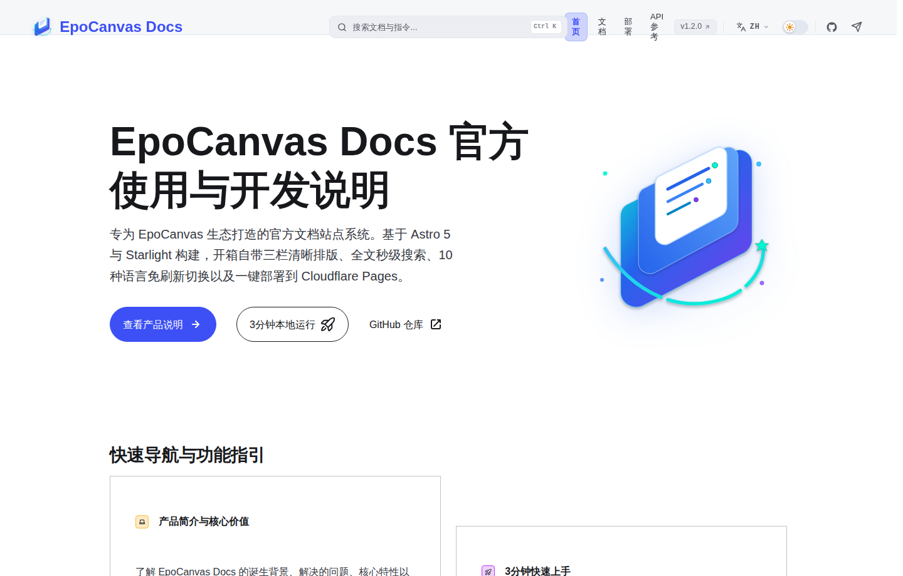

# EpoCanvas Docs

[](https://github.com/shijianus/epocanvas-docs/releases)
[](https://github.com/shijianus/epocanvas-docs/actions/workflows/build.yml)
[](./LICENSE)
[](https://docs.epocanvas.com)

[English](./README.md) | [简体中文](./README.zh-CN.md) | [繁體中文](./README.zh-TW.md) | [Français](./README.fr.md) | [Español](./README.es.md) | [Deutsch](./README.de.md) | [Português](./README.pt.md) | [Русский](./README.ru.md) | [日本語](./README.ja.md) | [한국어](./README.ko.md)

EpoCanvas Docs es el sitio de documentación oficial del proyecto EpoCanvas. Está construido con Astro 7 y Starlight, e incorpora de serie una maquetación de lectura de tres columnas, búsqueda de doble modo y contenido multilingüe completo. Todo el contenido está escrito en Markdown o MDX y se publica en Cloudflare Pages.

**Sitio en línea**: [https://docs.epocanvas.com](https://docs.epocanvas.com) (réplica: [https://epocanvas-docs.pages.dev](https://epocanvas-docs.pages.dev))

## Vista previa



*Ejemplo histórico de la interfaz: esta captura compartida de la portada en chino muestra v1.2.0 y Astro 5, no la candidata actual. El texto sobre el cambio de idioma y las posiciones de los controles corresponden a esa versión; siga la documentación actual. No es una captura de las pruebas de aceptación de esta candidata.*

El sitio usa una maquetación de tres columnas: el catálogo de categorías a la izquierda, el cuerpo del texto al centro y el índice de la página actual a la derecha. El tema sigue la preferencia del sistema en la primera visita; una selección manual la sustituye.

## Características

- **Maquetación de lectura de tres columnas** — el ancho del contenido está limitado para facilitar la lectura prolongada; la barra lateral conserva su posición de desplazamiento al cambiar de página, y el índice de la derecha resalta la sección actual mientras se desplaza.
- **Búsqueda de doble modo** — el cuadro de búsqueda de la barra superior localiza coincidencias dentro de la página actual, mientras que `Ctrl+K` / `Cmd+K` abre un diálogo de búsqueda en todo el sitio basado en Pagefind. El índice se genera al compilar y todas las consultas se ejecutan en el navegador, sin servicios de búsqueda de terceros, por lo que el sitio también funciona en intranets sin acceso a Internet.
- **Contenido multilingüe completo** — la interfaz y el cuerpo de cada artículo están disponibles en 10 idiomas: chino simplificado (predeterminado), chino tradicional, inglés, japonés, coreano, español, francés, alemán, ruso y portugués. Cada idioma vive bajo su propio prefijo de URL (p. ej. `/es/`), y las páginas sin traducción muestran la versión china en lugar de un 404.
- **Extensiones de Markdown** — cuatro tipos de bloques de aviso (`:::note`, `:::tip`, `:::caution`, `:::danger`), resaltado de código con Shiki, etiquetas de nombre de archivo, resaltado de líneas y renderizado de diff.
- **Despliegue con un comando** — el sitio se compila en archivos estáticos y se publica en Cloudflare Pages con un solo comando; los dominios personalizados y los certificados HTTPS se aprovisionan automáticamente.

## Requisitos

- Node.js `^22.23.4 || ^24.12.0`
- pnpm 10.34.5 (versión exacta)

CI usa Node.js 22.23.4, fijado en `.node-version`.

## Inicio rápido

```bash
npm install -g pnpm@10.34.5
git clone https://github.com/shijianus/epocanvas-docs.git
cd epocanvas-docs
pnpm install
pnpm run dev
```

Abra `http://localhost:4321` en su navegador. Mientras el servidor de desarrollo está en marcha, los cambios en Markdown se reflejan de inmediato.

### Comandos

| Comando | Descripción |
| :--- | :--- |
| `pnpm run dev` | Inicia el servidor de desarrollo local con recarga en caliente |
| `pnpm run build` | Compila el sitio estático en `dist/` y genera el índice de búsqueda |
| `pnpm run verify` | Ejecuta pruebas, comprobaciones de configuración y tipos de Astro, la compilación y comprobaciones de contenido y artefactos |
| `pnpm run preview` | Previsualiza el resultado de la compilación en local |
| `pnpm run deploy` | Comprueba los requisitos de despliegue, ejecuta verify y publica en Cloudflare Pages |

## Estructura del proyecto

```text
epocanvas-docs/
├── public/images/canvas/       # Capturas de pantalla y diagramas usados por la documentación
├── src/
│   ├── components/starlight/   # Componentes de Starlight sobrescritos (Header, Sidebar, …)
│   ├── config/navigation.ts    # Configuración de la barra de navegación superior
│   ├── content/docs/           # Contenido de la documentación por idioma (canvas/ = chino, en/ ja/ … = traducciones)
│   ├── styles/custom.css       # Colores del tema y estilos de maquetación
│   └── utils/i18n.ts           # Textos de la interfaz y registro de idiomas
├── astro.config.mjs            # Configuración del sitio: título, sidebar, redirecciones
├── AGENTS.md                   # Guía de redacción técnica
├── LICENSE
└── package.json
```

## Escribir documentación

1. Cree un nuevo archivo `.md` bajo `src/content/docs/canvas/`.
2. Añada el frontmatter al principio del archivo:

   ```yaml
   ---
   title: Título del documento
   description: Una descripción de la página en una sola frase
   ---
   ```

3. Registre la página en el array `sidebar` de `astro.config.mjs`; las páginas no registradas no aparecen en la navegación.
4. Guarde las imágenes en `public/images/canvas/` y referéncielas con una ruta absoluta:

   ```markdown
   
   ```

5. Complete las páginas correspondientes en `src/content/docs/<locale>/canvas/` para los otros 9 idiomas, añada las `translations` de la barra lateral y las imágenes que necesiten traducción en `public/images/canvas/<locale>/`. Los 10 idiomas deben estar completos antes de publicar; el fallback al chino solo es una protección del framework. Las traducciones ausentes hacen fallar `pnpm run verify` y CI.

Ejecute `pnpm run verify` antes de confirmar cambios y compruebe que pasan todas las verificaciones.

## Despliegue

El sitio está alojado en Cloudflare Pages:

- **Publicación local** — ejecute una vez `npx wrangler login` y después `pnpm run deploy`. El despliegue lo ejecuta `scripts/verify-release.mjs`, que rechaza ramas distintas de `main`, un árbol de trabajo con cambios o un HEAD que no coincida con el commit real de `origin/main` en el remoto. Ejecuta `pnpm run verify` antes de Wrangler. El nombre del proyecto está definido en este script, no en `package.json`.
- **Dominio personalizado** — en el panel de Cloudflare, abra el proyecto de Pages `epocanvas-docs` y añada el dominio en *Custom domains*. El registro CNAME y el certificado SSL se aprovisionan automáticamente.

## Contribuir

Las incidencias y los pull requests son bienvenidos. Ejecute `pnpm run verify` en local y compruebe que pasan todas las verificaciones antes de enviar un PR.

## Licencia

[MIT](./LICENSE)
