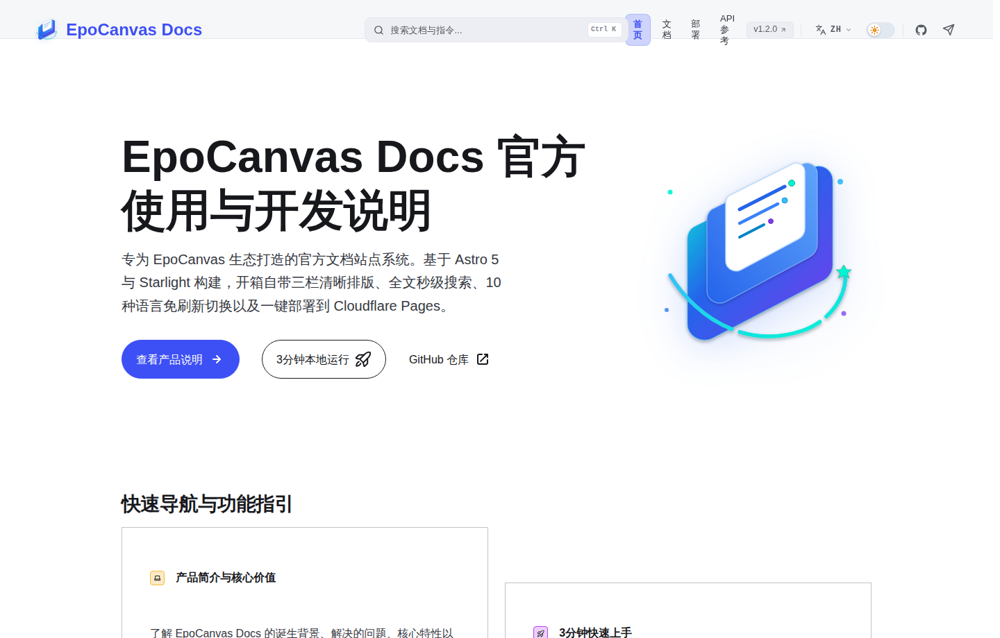

# EpoCanvas Docs

[](https://github.com/shijianus/epocanvas-docs/releases)
[](https://github.com/shijianus/epocanvas-docs/actions/workflows/build.yml)
[](./LICENSE)
[](https://docs.epocanvas.com)

[English](./README.md) | [简体中文](./README.zh-CN.md) | [繁體中文](./README.zh-TW.md) | [Français](./README.fr.md) | [Español](./README.es.md) | [Deutsch](./README.de.md) | [Português](./README.pt.md) | [Русский](./README.ru.md) | [日本語](./README.ja.md) | [한국어](./README.ko.md)

EpoCanvas Docs est le site de documentation officiel du projet EpoCanvas. Il repose sur Astro 7 et Starlight et propose, dès l'installation, une mise en page de lecture à trois colonnes, une recherche en deux modes et un contenu entièrement multilingue. Le contenu est rédigé en Markdown ou MDX et publié sur Cloudflare Pages.

**Site en ligne** : [https://docs.epocanvas.com](https://docs.epocanvas.com) (miroir : [https://epocanvas-docs.pages.dev](https://epocanvas-docs.pages.dev))

## Aperçu



*Exemple historique de l’interface : cette capture commune de la page d’accueil en chinois montre v1.2.0 et Astro 5, et non la candidate actuelle. Le texte sur le changement de langue et la position des commandes datent de cette version ; suivez la documentation actuelle. Il ne s’agit pas d’une capture des tests d’acceptation de cette candidate.*

Le site utilise une mise en page à trois colonnes : navigation par catégories à gauche, contenu de l'article au centre et table des matières de la page en cours à droite. Le thème suit les préférences du système lors de la première visite ; un choix manuel les remplace.

## Fonctionnalités

- **Mise en page de lecture à trois colonnes** — la largeur du contenu est limitée pour faciliter la lecture longue ; la barre latérale conserve sa position de défilement d'une page à l'autre, et le sommaire à droite surligne la section en cours pendant le défilement.
- **Recherche en deux modes** — le champ de recherche de l'en-tête recherche dans la page en cours, tandis que `Ctrl+K` / `Cmd+K` ouvre une fenêtre de recherche sur l'ensemble du site, propulsée par Pagefind. L'index est généré au moment de la compilation et toutes les requêtes s'exécutent dans le navigateur, sans service de recherche tiers ; le site fonctionne donc également sur un réseau interne sans accès à Internet.
- **Contenu entièrement multilingue** — l'interface et le texte de chaque article sont disponibles en 10 langues : chinois simplifié (par défaut), chinois traditionnel, anglais, japonais, coréen, espagnol, français, allemand, russe et portugais. Chaque langue possède son propre préfixe d'URL (par ex. `/en/`) ; les pages sans traduction affichent automatiquement le chinois au lieu d'une erreur 404.
- **Extensions Markdown** — quatre types d'encadrés (`:::note`, `:::tip`, `:::caution`, `:::danger`), coloration syntaxique Shiki avec étiquette de nom de fichier, surlignage de lignes et rendu des diffs.
- **Déploiement en une commande** — le site est compilé en fichiers statiques et publié sur Cloudflare Pages ; les domaines personnalisés et les certificats HTTPS sont configurés automatiquement.

## Prérequis

- Node.js `^22.23.4 || ^24.12.0`
- pnpm 10.34.5 (version exacte)

La CI utilise Node.js 22.23.4, fixé dans `.node-version`.

## Démarrage rapide

```bash
npm install -g pnpm@10.34.5
git clone https://github.com/shijianus/epocanvas-docs.git
cd epocanvas-docs
pnpm install
pnpm run dev
```

Ouvrez `http://localhost:4321` dans votre navigateur. Tant que le serveur de développement est en cours d'exécution, les modifications Markdown sont reflétées immédiatement.

### Commandes

| Commande | Description |
| :--- | :--- |
| `pnpm run dev` | Démarre le serveur de développement local avec rechargement à chaud |
| `pnpm run build` | Compile le site statique dans `dist/` et génère l'index de recherche |
| `pnpm run verify` | Exécute les tests, les contrôles de configuration et de types Astro, le build et les contrôles du contenu et des artefacts |
| `pnpm run preview` | Prévisualise le résultat de la compilation en local |
| `pnpm run deploy` | Vérifie les prérequis, exécute verify, puis publie sur Cloudflare Pages |

## Structure du projet

```text
epocanvas-docs/
├── public/images/canvas/       # Captures d'écran et schémas utilisés par la documentation
├── src/
│   ├── components/starlight/   # Composants Starlight surchargés (Header, Sidebar, …)
│   ├── config/navigation.ts    # Configuration de la barre de navigation supérieure
│   ├── content/docs/           # Contenu de la documentation, rédigé en Markdown
│   ├── styles/custom.css       # Couleurs du thème et styles de mise en page
│   └── utils/i18n.ts           # Textes d'interface et registre des langues
├── astro.config.mjs            # Configuration du site : titre, barre latérale, redirections
├── AGENTS.md                   # Lignes directrices rédactionnelles
├── LICENSE
└── package.json
```

## Rédiger la documentation

1. Créez un nouveau fichier `.md` dans `src/content/docs/canvas/`.
2. Ajoutez le frontmatter au début du fichier :

   ```yaml
   ---
   title: Titre du document
   description: Description de la page en une phrase
   ---
   ```

3. Enregistrez la page dans le tableau `sidebar` de `astro.config.mjs` ; une page non enregistrée n'apparaît pas dans la navigation.
4. Placez les images dans `public/images/canvas/` et référencez-les avec un chemin absolu :

   ```markdown
   
   ```

5. Complétez les pages correspondantes dans `src/content/docs/<locale>/canvas/` pour les 9 autres langues, les `translations` de la barre latérale et les images à traduire dans `public/images/canvas/<locale>/`. Les 10 langues doivent être complètes avant publication ; le repli vers le chinois est seulement une protection du framework. Les traductions manquantes font échouer `pnpm run verify` et la CI.

Exécutez `pnpm run verify` avant de committer et vérifiez que tous les contrôles passent.

## Déploiement

Le site est hébergé sur Cloudflare Pages :

- **Publication locale** — exécutez une fois `npx wrangler login`, puis `pnpm run deploy`. Le déploiement passe par `scripts/verify-release.mjs`, qui refuse toute branche autre que `main`, un répertoire de travail non propre ou un HEAD différent du commit réel de `origin/main` sur le serveur distant. Il exécute `pnpm run verify` avant Wrangler. Le nom du projet est défini dans ce script, pas dans `package.json`.
- **Domaine personnalisé** — dans le tableau de bord Cloudflare, ouvrez le projet Pages `epocanvas-docs` et ajoutez le domaine dans *Custom domains*. L'enregistrement CNAME et le certificat SSL sont provisionnés automatiquement.

## Contributions

Les issues et les pull requests sont les bienvenues. Avant de soumettre une PR, exécutez `pnpm run verify` en local et vérifiez que tous les contrôles passent.

## Licence

[MIT](./LICENSE)
