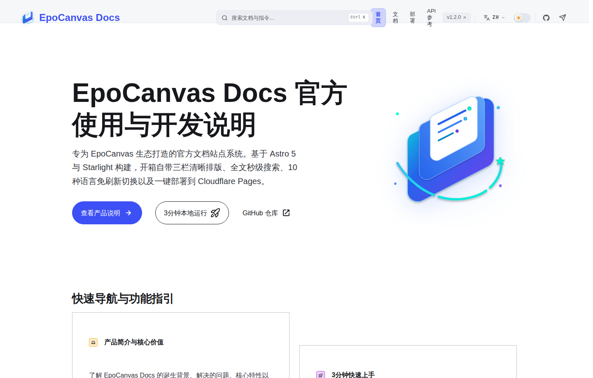

# EpoCanvas Docs

[](https://github.com/shijianus/epocanvas-docs/releases)
[](https://github.com/shijianus/epocanvas-docs/actions/workflows/build.yml)
[](./LICENSE)
[](https://docs.epocanvas.com)

[English](./README.md) | [简体中文](./README.zh-CN.md) | [繁體中文](./README.zh-TW.md) | [Français](./README.fr.md) | [Español](./README.es.md) | [Deutsch](./README.de.md) | [Português](./README.pt.md) | [Русский](./README.ru.md) | [日本語](./README.ja.md) | [한국어](./README.ko.md)

O EpoCanvas Docs é o site de documentação oficial do projeto EpoCanvas. É construído com Astro 7 e Starlight e traz de origem uma disposição de leitura em três colunas, pesquisa de dois modos e conteúdo multilingue completo. Todo o conteúdo é escrito em Markdown ou MDX e publicado no Cloudflare Pages.

**Site online**: [https://docs.epocanvas.com](https://docs.epocanvas.com) (réplica: [https://epocanvas-docs.pages.dev](https://epocanvas-docs.pages.dev))

## Pré-visualização



*Exemplo histórico da interface: esta captura comum da página inicial em chinês mostra v1.2.0 e Astro 5, não a candidata atual. O texto sobre a mudança de idioma e as posições dos controlos pertencem à versão antiga; siga a documentação atual. Não é uma captura dos testes de aceitação desta candidata.*

O site usa uma disposição de três colunas: navegação por categorias à esquerda, conteúdo do artigo ao centro e índice da página atual à direita. Na primeira visita, o tema segue a preferência do sistema; uma escolha manual passa a ter prioridade.

## Funcionalidades

- **Disposição de leitura em três colunas** — a largura do conteúdo é limitada para leituras longas; a barra lateral mantém a posição de rolagem ao mudar de página, e o índice à direita destaca a secção atual durante a rolagem.
- **Pesquisa de dois modos** — o campo de pesquisa na barra superior encontra correspondências na página atual, enquanto `Ctrl+K` / `Cmd+K` abre uma janela de pesquisa em todo o site baseada no Pagefind. O índice é gerado durante a compilação e todas as consultas correm no navegador, sem serviços de pesquisa de terceiros — o site também funciona em intranets sem acesso à Internet.
- **Conteúdo multilingue completo** — a interface e o corpo de cada artigo estão disponíveis em 10 idiomas: chinês simplificado (predefinido), chinês tradicional, inglês, japonês, coreano, espanhol, francês, alemão, russo e português. Cada idioma vive no seu próprio prefixo de URL (p. ex. `/pt/`), e as páginas sem tradução mostram a versão chinesa em vez de um 404.
- **Extensões de Markdown** — quatro tipos de blocos de aviso (`:::note`, `:::tip`, `:::caution`, `:::danger`), destaque de código com Shiki, etiquetas de nome de ficheiro, destaque de linhas e renderização de diff.
- **Implantação com um comando** — o site compila-se em ficheiros estáticos e publica-se no Cloudflare Pages com um único comando; domínios personalizados e certificados HTTPS são aprovisionados automaticamente.

## Requisitos

- Node.js `^22.23.4 || ^24.12.0`
- pnpm 10.34.5 (versão exata)

O CI usa Node.js 22.23.4, fixado em `.node-version`.

## Início rápido

```bash
npm install -g pnpm@10.34.5
git clone https://github.com/shijianus/epocanvas-docs.git
cd epocanvas-docs
pnpm install
pnpm run dev
```

Abra `http://localhost:4321` no navegador. Enquanto o servidor de desenvolvimento estiver em execução, as alterações em Markdown refletem-se de imediato.

### Comandos

| Comando | Descrição |
| :--- | :--- |
| `pnpm run dev` | Inicia o servidor de desenvolvimento local com recarga dinâmica |
| `pnpm run build` | Compila o site estático para `dist/` e gera o índice de pesquisa |
| `pnpm run verify` | Executa testes, verificações de configuração e tipos do Astro, o build e verificações de conteúdo e artefactos |
| `pnpm run preview` | Pré-visualiza o resultado da compilação em local |
| `pnpm run deploy` | Verifica os pré-requisitos, executa verify e publica no Cloudflare Pages |

## Estrutura do projeto

```text
epocanvas-docs/
├── public/images/canvas/       # Capturas de ecrã e diagramas usados pela documentação
├── src/
│   ├── components/starlight/   # Componentes de Starlight sobrepostos (Header, Sidebar, …)
│   ├── config/navigation.ts    # Configuração da barra de navegação superior
│   ├── content/docs/           # Conteúdo da documentação por idioma (canvas/ = chinês, en/ ja/ … = traduções)
│   ├── styles/custom.css       # Cores do tema e estilos de disposição
│   └── utils/i18n.ts           # Textos da interface e registo de idiomas
├── astro.config.mjs            # Configuração do site: título, sidebar, redirecionamentos
├── AGENTS.md                   # Guia de redação técnica
├── LICENSE
└── package.json
```

## Escrever documentação

1. Crie um novo ficheiro `.md` em `src/content/docs/canvas/`.
2. Acrescente o frontmatter no início do ficheiro:

   ```yaml
   ---
   title: Título do documento
   description: Uma descrição da página numa só frase
   ---
   ```

3. Registe a página no array `sidebar` de `astro.config.mjs`; páginas não registadas não aparecem na navegação.
4. Guarde as imagens em `public/images/canvas/` e referencie-as com um caminho absoluto:

   ```markdown
   
   ```

5. Complete as páginas correspondentes em `src/content/docs/<locale>/canvas/` para os outros 9 idiomas, as `translations` da barra lateral e as imagens que precisem de tradução em `public/images/canvas/<locale>/`. Os 10 idiomas têm de estar completos antes da publicação; o fallback para chinês é apenas uma proteção do framework. Traduções em falta fazem falhar `pnpm run verify` e o CI.

Execute `pnpm run verify` antes de submeter e confirme que todas as verificações passam.

## Implantação

O site está alojado no Cloudflare Pages:

- **Publicação local** — execute uma vez `npx wrangler login` e depois `pnpm run deploy`. A implantação é executada por `scripts/verify-release.mjs`, que rejeita ramos diferentes de `main`, uma árvore de trabalho com alterações ou um HEAD diferente do commit real de `origin/main` no remoto. Executa `pnpm run verify` antes do Wrangler. O nome do projeto está definido neste script, não em `package.json`.
- **Domínio personalizado** — na consola da Cloudflare, abra o projeto de Pages `epocanvas-docs` e acrescente o domínio em *Custom domains*. O registo CNAME e o certificado SSL são aprovisionados automaticamente.

## Contribuir

Issues e pull requests são bem-vindos. Execute `pnpm run verify` em local e confirme que todas as verificações passam antes de submeter um PR.

## Licença

[MIT](./LICENSE)
