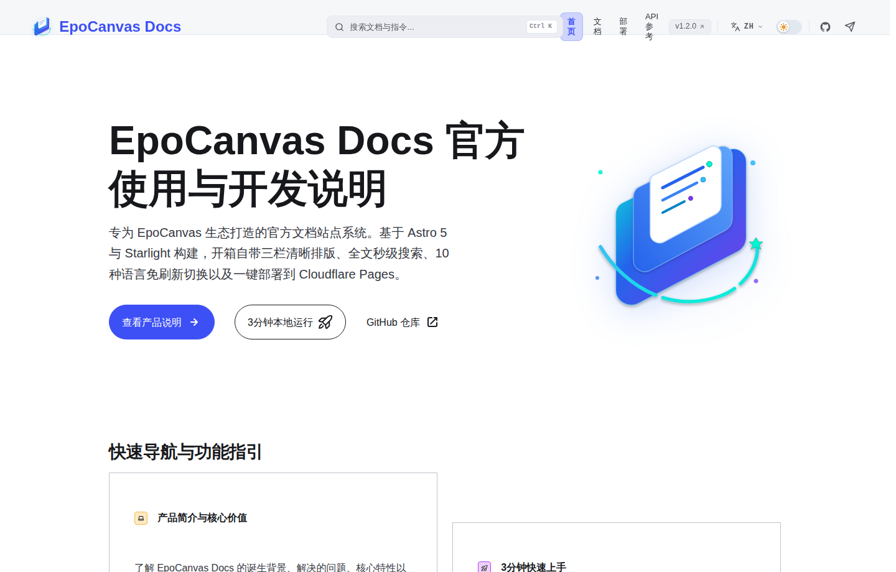

# EpoCanvas Docs

[](https://github.com/shijianus/epocanvas-docs/releases)
[](https://github.com/shijianus/epocanvas-docs/actions/workflows/build.yml)
[](./LICENSE)
[](https://docs.epocanvas.com)

[English](./README.md) | [简体中文](./README.zh-CN.md) | [繁體中文](./README.zh-TW.md) | [Français](./README.fr.md) | [Español](./README.es.md) | [Deutsch](./README.de.md) | [Português](./README.pt.md) | [Русский](./README.ru.md) | [日本語](./README.ja.md) | [한국어](./README.ko.md)

EpoCanvas Docs — официальный сайт документации проекта EpoCanvas. Построен на Astro 7 и Starlight и изначально включает трёхколоночный макет для чтения, поиск с двумя режимами и полную многоязычность контента. Всё содержимое написано на Markdown или MDX и публикуется на Cloudflare Pages.

**Сайт**: [https://docs.epocanvas.com](https://docs.epocanvas.com) (зеркало: [https://epocanvas-docs.pages.dev](https://epocanvas-docs.pages.dev))

## Предпросмотр



*Исторический пример интерфейса: общий скриншот китайской главной страницы показывает v1.2.0 и Astro 5, а не текущую кандидатную версию. Текст о переключении языков и расположение элементов относятся к прежней версии; следуйте актуальной документации. Это не скриншот приёмочных испытаний текущего кандидата.*

Сайт использует трёхколоночный макет: слева навигация по категориям, в центре текст статьи, справа оглавление текущей страницы. При первом посещении тема следует настройкам системы; после ручного выбора используется сохранённая тема.

## Возможности

- **Трёхколоночный макет для чтения** — ширина текста ограничена для удобного долгого чтения; боковая панель сохраняет позицию прокрутки при переходе между страницами, а правое оглавление подсвечивает текущий раздел при прокрутке.
- **Поиск с двумя режимами** — поле поиска в верхней панели находит совпадения на текущей странице, а `Ctrl+K` / `Cmd+K` открывает диалог поиска по всему сайту на основе Pagefind. Индекс создаётся при сборке, все запросы выполняются в браузере без сторонних поисковых служб — сайт работает даже в интранете без доступа к внешней сети.
- **Полностью многоязычный контент** — интерфейс и текст каждой статьи доступны на 10 языках: упрощённый китайский (по умолчанию), традиционный китайский, английский, японский, корейский, испанский, французский, немецкий, русский и португальский. Каждый язык живёт под собственным префиксом URL (например, `/ru/`); страницы без перевода показывают китайскую версию вместо ошибки 404.
- **Расширения Markdown** — четыре типа выносок (`:::note`, `:::tip`, `:::caution`, `:::danger`), подсветка кода Shiki с подписями имён файлов, подсветкой строк и отображением diff.
- **Развёртывание одной командой** — сайт собирается в статические файлы и публикуется на Cloudflare Pages одной командой; собственные домены и сертификаты HTTPS настраиваются автоматически.

## Требования

- Node.js `^22.23.4 || ^24.12.0`
- pnpm 10.34.5 (точная версия)

CI использует Node.js 22.23.4, зафиксированный в `.node-version`.

## Быстрый старт

```bash
npm install -g pnpm@10.34.5
git clone https://github.com/shijianus/epocanvas-docs.git
cd epocanvas-docs
pnpm install
pnpm run dev
```

Откройте `http://localhost:4321` в браузере. Пока сервер разработки запущен, изменения в Markdown сразу отражаются на странице.

### Команды

| Команда | Описание |
| :--- | :--- |
| `pnpm run dev` | Запускает локальный сервер разработки с горячей перезагрузкой |
| `pnpm run build` | Собирает статический сайт в `dist/` и создаёт поисковый индекс |
| `pnpm run verify` | Выполняет тесты, проверки конфигурации и типов Astro, сборку и проверки содержимого и артефактов |
| `pnpm run preview` | Локальный предпросмотр результата сборки |
| `pnpm run deploy` | Проверяет условия развёртывания, запускает verify и публикует на Cloudflare Pages |

## Структура проекта

```text
epocanvas-docs/
├── public/images/canvas/       # Скриншоты и диаграммы, используемые в документации
├── src/
│   ├── components/starlight/   # Переопределённые компоненты Starlight (Header, Sidebar, …)
│   ├── config/navigation.ts    # Конфигурация верхней панели навигации
│   ├── content/docs/           # Содержимое документации по языкам (canvas/ = китайский, en/ ja/ … = переводы)
│   ├── styles/custom.css       # Цвета темы и стили макета
│   └── utils/i18n.ts           # Тексты интерфейса и реестр языков
├── astro.config.mjs            # Конфигурация сайта: заголовок, sidebar, перенаправления
├── AGENTS.md                   # Руководство по написанию технических текстов
├── LICENSE
└── package.json
```

## Написание документации

1. Создайте новый файл `.md` в `src/content/docs/canvas/`.
2. Добавьте frontmatter в начало файла:

   ```yaml
   ---
   title: Заголовок документа
   description: Описание страницы одним предложением
   ---
   ```

3. Зарегистрируйте страницу в массиве `sidebar` в `astro.config.mjs`; незарегистрированные страницы не появляются в навигации.
4. Храните изображения в `public/images/canvas/` и ссылайтесь на них абсолютным путём:

   ```markdown
   
   ```

5. Подготовьте соответствующие страницы в `src/content/docs/<locale>/canvas/` для остальных 9 языков, `translations` боковой панели и изображения, требующие перевода, в `public/images/canvas/<locale>/`. Перед публикацией должны быть готовы все 10 языков; возврат к китайскому — лишь защитный механизм фреймворка. Отсутствие переводов приводит к отказу `pnpm run verify` и CI.

Перед коммитом выполните `pnpm run verify` и убедитесь, что все проверки пройдены.

## Развёртывание

Сайт размещён на Cloudflare Pages:

- **Локальная публикация** — один раз выполните `npx wrangler login`, затем `pnpm run deploy`. Развёртывание выполняет `scripts/verify-release.mjs`: он отклоняет ветки, отличные от `main`, рабочее дерево с изменениями и HEAD, не совпадающий с фактическим коммитом `origin/main` на удалённом сервере. Перед Wrangler запускается `pnpm run verify`. Имя проекта задано в этом скрипте, а не в `package.json`.
- **Собственный домен** — в консоли Cloudflare откройте проект Pages `epocanvas-docs` и добавьте домен в разделе *Custom domains*. Запись CNAME и сертификат SSL настраиваются автоматически.

## Участие в разработке

Приветствуются issue и pull request. Перед отправкой PR выполните `pnpm run verify` локально и убедитесь, что все проверки пройдены.

## Лицензия

[MIT](./LICENSE)
